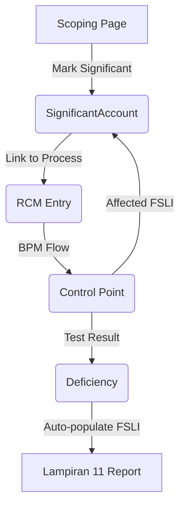

# Design: Bidirectional FSLI & BPM Linking

## Architecture Overview
Fitur ini menghubungkan modul **Scoping** (Financial) dan **RCM/BPM** (Operational) melalui referensi `fsliCode`. 



## Data Model Changes (`shared/types.ts`)

### 1. `Control` Interface
Menambahkan field `fsliCodes` untuk menyimpan daftar akun yang diproteksi oleh kontrol tersebut.
```typescript
export interface Control {
  // ... existing fields
  fsliCodes?: string[]; // New: Linked FSLI codes from Scoping
}
```

### 2. `SignificantAccount` Interface
Menambahkan field opsional untuk menyimpan relasi ke proses bisnis.
```typescript
export interface SignificantAccount {
  // ... existing fields
  relatedProcessIds?: string[]; // New: IDs of RCM processes covering this account
}
```

## UI Design Decisions

### 1. Scoping Page (`src/pages/scoping/ScopingPage.tsx`)
-   **Action Column:** Tambahkan ikon 🔗 pada tabel Akun Signifikan.
-   **Navigation:** Saat diklik, arahkan ke `/rcm` dengan query parameter `?fsliCode=...`.

### 2. RCM List & BPM Editor (`src/pages/rcm/RCMList.tsx` & `src/components/rcm/BPMEditor.tsx`)
-   **Drilldown Panel:** Tambahkan level baru setelah "Control Details".
-   **FSLI Selector:** Dropdown pencarian yang hanya mengambil data dari `MaterialityEntity` (Akun yang ditandai `isQuantitative: true` atau memiliki `qualitativeReasons`).

### 3. Reporting (`src/components/reports/RegulatoryAppendices.tsx`)
-   **Logic:** `Lampiran11Report` akan memetakan `deficiency.controlId` ke `Control.fsliCodes`.
-   **Display:** Menampilkan deskripsi akun FSLI alih-alih hanya kode.

## API Integration (`worker/user-routes.ts`)
-   **GET /api/scoping/significant-accounts:** Endpoint baru (atau filter) untuk mengambil daftar akun yang masuk scope untuk dropdown di BPM.
-   **PUT /api/controls/:id:** Harus menangani update `fsliCodes`.

## Implementation Phases
1.  **Phase 1:** Update Shared Types & API Endpoints.
2.  **Phase 2:** Implement FSLI Selection di BPM Editor side-panel.
3.  **Phase 3:** Implement navigasi dari Scoping ke RCM.
4.  **Phase 4:** Update Lampiran 11 Report logic.
